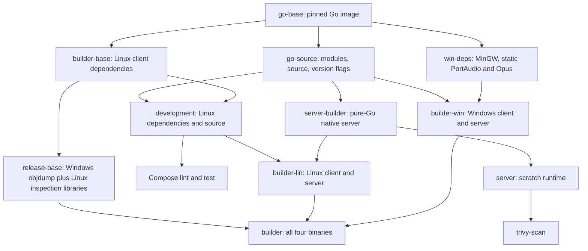

# Building GoSpeak

GoSpeak uses multi-stage container builds to compile all binaries and provide a
consistent build environment for native dependencies such as PortAudio, Opus,
and OpenGL. Container base images, Windows PortAudio and Opus sources, GitHub
Actions, Go, and golangci-lint are pinned. Debian, Homebrew, and runner package
indexes remain external mutable inputs, so builds are not bit-for-bit
reproducible.

## Prerequisites

- **Podman** (or Docker) is used for container builds.
- **Go 1.26.11 or newer** is only needed for local development without containers.

## Quick Build

Before starting the server, prepare its data mount using the [rootful or rootless instructions](#server-container).

### Using Docker Compose

```bash
# Build and run the server
docker compose up --build

# Or with Podman Compose
podman-compose up --build

# Extract all 4 binaries to ./bin/
docker compose --profile build run --build builder

# Windows binaries only → ./bin/
docker compose --profile build-win run --build builder-win

# Linux binaries only → ./bin/
docker compose --profile build-lin run --build builder-lin

# Run golangci-lint
docker compose --profile dev run --build lint
```

## Build Outputs

| Binary | OS | Description |
|--------|----|-------------|
| `gospeak-server` | Linux | Statically linked pure-Go server |
| `gospeak-server-win.exe` | Windows | Server binary (pure Go, CGO_ENABLED=0) |
| `gospeak-client-lin` | Linux | Client with Fyne GUI, PortAudio, Opus |
| `gospeak-client-win.exe` | Windows | Client cross-compiled with MinGW |

Release CI inspects Linux dependencies with `ldd`, Windows imports with
`objdump`, and macOS dependencies with `otool -L`. The Windows PortAudio and
Opus libraries are linked statically. Linux users need the runtime PortAudio,
Opus, OpenGL, and X11 libraries supplied by their distribution. On Debian or
Ubuntu, install `libportaudio2 libopus0 libgl1 libx11-6 libxcursor1 libxrandr2
libxinerama1 libxi6 libxxf86vm1`. macOS users need `portaudio` and `opus` from
Homebrew until GoSpeak ships an application bundle.

Release tags must use SemVer without build metadata. Push one release tag at a
time and wait for its workflow to finish: GitHub Actions keeps only one pending
run in a concurrency group. Stable releases also update the `latest` container
tag; prereleases publish only their versioned tag. The GitHub release is created
only after the scanned container image has been published.

## Container Build Stages



The `server` target never installs system packages or builds clients. The
`builder-lin` and `builder-win` targets compile only their platform's binaries;
only `builder` joins both paths. Compose lint/test use `development` without
compiling release binaries first. Linux outputs use the container platform's
architecture; Windows outputs remain `amd64`.

### Layer Caching Strategy

1. **System dependencies** are installed before source copies and release metadata.
2. **Windows native libraries** depend on their pinned source refs and CMake config,
   not Go source or version metadata.
3. **Go modules** stay cached until `go.mod` or `go.sum` changes.
4. **Go source and version flags** feed only the requested build paths. Source
   changes rerun compilation, not apt or CMake.

## Server Container

The server runs as UID:GID `10001:10001`; `/data` is owned by that account with mode `0700`. Fresh named volumes inherit this directory. The supplied Compose files drop all Linux capabilities and set `no-new-privileges`.

For a fresh development Compose bind mount with a rootful engine without user-namespace remapping, run `sudo install -d -m 0700 -o 10001 -g 10001 ./data` before starting. For rootless Podman, run `podman unshare install -d -m 0700 -o 10001 -g 10001 ./data` as the invoking user on a fresh path instead; do not first assign host UID 10001. Other engines, including rootless Docker, require their own user-namespace/mapping procedure: container UID 10001 is not necessarily host UID 10001.

For existing bind mounts or named volumes, stop the server and restart/update automation, take a private backup, and migrate only the dedicated GoSpeak data path without following symlinks. The directory and its database, sidecars, certificates and bootstrap file must belong to container UID:GID `10001:10001`; retain `0700` directories and `0600` private files. Rootless namespace ownership changes work only on accessible data owned by or mapped to that rootless user. Data owned by host root or an external host UID (including host UID 10001) requires a privileged, explicitly scoped migration to the engine's actual mapped host owner first; an unprivileged namespace chown cannot repair it. Verify ownership and modes in the engine's namespace before starting or enabling auto-updates; wrong ownership fails closed. The image does not repair permissions or start as root.

The runtime image contains only the statically linked server. It has no shell,
package manager, C runtime, or CA bundle because the server accepts inbound TLS
connections but does not make outbound TLS requests.

```bash
# Run standalone server
docker run -p 9600:9600 -p 9601:9601/udp \
  -v gospeak-data:/data \
  gospeak-server

# The server stores its database and TLS certs in /data
```

### Server Flags

| Flag | Default | Description |
|------|---------|-------------|
| `-control` | `:9600` | TCP/TLS control plane bind address |
| `-voice` | `:9601` | UDP voice bind address |
| `-db` | `gospeak.db` | SQLite database path |
| `-data` | `.` | Directory for automatic TLS and bootstrap credential files; `-db` controls the database separately |
| `-cert` | *(empty)* | Custom TLS certificate, including self-signed; requires `-key` |
| `-key` | *(empty)* | Matching private key; requires `-cert`. Empty pair enables automatic self-signed mode in `-data`; the first new TLS connection within 30 days of expiry renews the certificate without rotating the key |
| `-open` | `false` | Allow first-time connections without an invite token (personal token still required on reconnect) |
| `-screen` | `:9603` | TCP/TLS screen-share relay bind address; at most 256 bytes when screen sharing is enabled |
| `-screen-share` | `false` | Enable per-channel screen sharing |
| `-channels-file` | *(none)* | YAML file defining channels to create on startup |
| `-metrics` | *(empty)* | HTTP bind address for Prometheus `/metrics` and `/healthz`; disabled by default |
| `-max-sessions` | `1024` | Maximum concurrent authenticated sessions; supported range 1..1024, non-positive values use the default |
| `-max-sessions-per-user` | `8` | Maximum concurrent sessions for one account; non-positive values use the default |
| `-max-sessions-per-source` | `64` | Active plus pending sessions per IPv4 address or IPv6 /64; non-positive values use the default |
| `-control-message-burst` | `60` | Per-session and aggregate per-user control-message cost burst; non-positive values use the default and values below 5 are raised to 5 |
| `-control-messages-per-second` | `10` | Per-session and aggregate per-user control-message cost replenished each second; non-positive values use the default |
| `-control-global-burst` | `300` | Server-wide control-message cost burst; non-positive values use the default and values below 5 are raised to 5 |
| `-control-global-messages-per-second` | `100` | Server-wide control-message cost replenished each second; non-positive values use the default |
| `-export-users` | `false` | Export all users as YAML and exit |
| `-export-channels` | `false` | Export all channels as YAML and exit |

File-backed exports require an existing `-db` source. A missing source fails before database creation or migration. Normal server startup still creates a missing database.

## Local Development (Without Containers)

For local development, you need the native dependencies installed:

### Linux (Debian/Ubuntu)

```bash
sudo apt install build-essential pkg-config \
  portaudio19-dev libopus-dev libgl1-mesa-dev \
  libx11-dev libxcursor-dev libxrandr-dev libxinerama-dev \
  libxi-dev libxxf86vm-dev

go build -tags nolibopusfile ./cmd/server/
go build -tags nolibopusfile ./cmd/client/
```

### Windows

Use the container build to cross-compile, or open an MSYS2 MinGW 64-bit shell,
put Go on `PATH`, and install PortAudio and Opus:

```bash
pacman -S --needed mingw-w64-x86_64-toolchain mingw-w64-x86_64-pkgconf \
  mingw-w64-x86_64-portaudio mingw-w64-x86_64-opus

export CGO_ENABLED=1
export CC=gcc
export PKG_CONFIG_PATH=/mingw64/lib/pkgconfig
go build -tags nolibopusfile ./cmd/server/
go build -tags nolibopusfile ./cmd/client/
```

### macOS

Go 1.26 builds require macOS 12 Monterey or newer.
Install the Xcode Command Line Tools first so a C compiler is available, then:

```bash
brew install pkg-config portaudio opus
go build -tags nolibopusfile ./cmd/server/
go build -tags nolibopusfile ./cmd/client/
```
